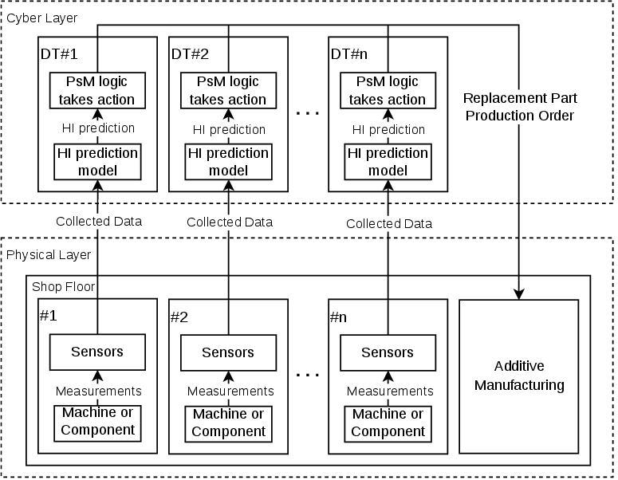

# IIoT Autonomous Maintenance - article version

**This is the version of the code used in the article.** It is kept as a record. For the later and more complete version, with a cleaner pipeline, new models, and full instructions, use the [`main` branch](https://github.com/pedrodsmota/iiot-autonomous-maintenance) (release `v2.0-dissertation`).

> P. Mota and R. Pinto, "An Industrial IoT Architecture for Autonomous Maintenance: Integrating Digital Twins, Distributed Control, and On-Demand Additive Manufacturing," *Applied Sciences*, 2026.

## What is here

The code is kept as it ran. The only changes are the removal of personal paths (data locations now come from `IIOT_DATA_DIR`), and of the OctoPrint key.

| Folder | Content |
|---|---|
| [`prognostics/`](prognostics/) | Offline pipeline: preprocessing, features, health labels, dataset, tuning, and training |
| [`models/`](models/) | The models deployed in the end-to-end trials, and their scalers |
| [`online/`](online/) | Online estimation scripts of the PdM nodes |
| [`iec61499/`](iec61499/) | Function blocks, screenshots of the applications (the `.sys` file was not preserved), and the G-code of the replacement part |
| [`acquisition/`](acquisition/) | Sampling utilities and Pico W firmware |
| [`validation/`](validation/) | Tests, their procedures, and their results |
| [`results/`](results/) | Table 4 and the prediction figures |
| [`environment/`](environment/) | Software versions reported in the article |

## How it differs from the `main` branch

| | This version (article) | `main` (dissertation) |
|---|---|---|
| Models | CNN-BiLSTM, RMSE 0.0334 / 0.0426 / 0.0644 | Retrained, RMSE 0.0492 / 0.0412 / 0.0840 |
| Evaluation | Random blocks; about 80% of the test sequences span two non-adjacent blocks | One contiguous sequence per test block, plus whole sessions held out |
| Prescriptive rule | Threshold on the HI (`HI_THRESHOLD`: 0.4 / 0.3 / 0.3) | Threshold on the RUL (`RUL_THRESHOLD`: 4.47 / 3.93 / 4.63 h) |
| End-to-end trials | Crossing to complete failure: 3 h 35 min to 3 h 38 min; margin 2 to 8 min | Margin 57 to 73 min |
| Response time | Measured locally on the AdM node, 258 to 336 ms | Publication on the PdM node to printing, 207 to 215 ms |

The results of the two versions come from different models and trials, so they are not interchangeable: cite the version you use.

## Dataset

The recordings are the same as in the `main` branch: [10.5281/zenodo.23900129](https://doi.org/10.5281/zenodo.23900129) ([data card](https://github.com/pedrodsmota/iiot-autonomous-maintenance/blob/main/dataset/README.md)). **Correction to the article:** it states that faults were introduced before each of sessions 16-21. They were introduced in five stages, in sessions 17-21, as in the data card. The dataset files built from them for the article (`*_dataset.pkl`, about 1.25 GB) are not published.

## Other software

The article reports DINASORE v1.0 (Python 3.8.18). The versions on each device, and the installation of the testbed, are described on the [`main` branch](https://github.com/pedrodsmota/iiot-autonomous-maintenance/blob/main/iec61499/README.md).

## License

Code: [MIT](LICENSE), except `acquisition/adxl345/` ([GPL-3.0](acquisition/adxl345/LICENSE)). Trained models, results, and documentation: [CC BY 4.0](https://creativecommons.org/licenses/by/4.0/).

`iec61499/replacement_part/gripper.gcode`: [CC BY-NC](iec61499/replacement_part/README.md) (non-commercial use only), the license of the gripper from which it was sliced.

---

Feito com ☕, paciência e muitas garras partidas na FEUP, no Porto. 🇵🇹
