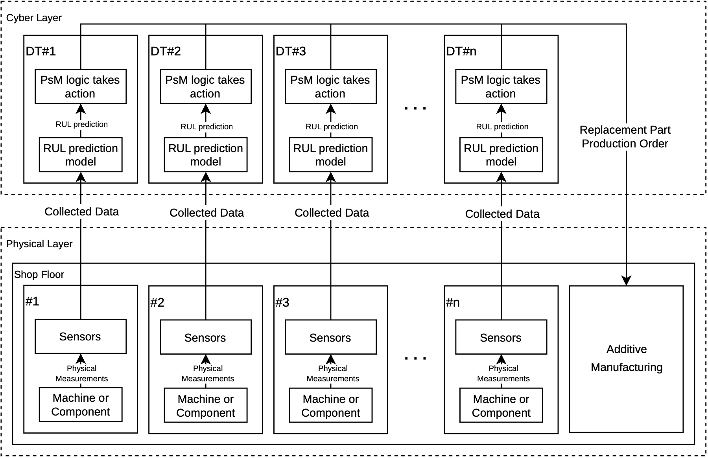
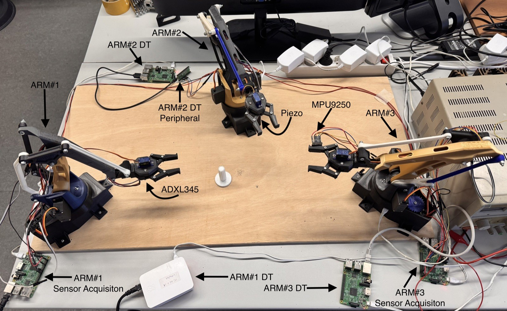
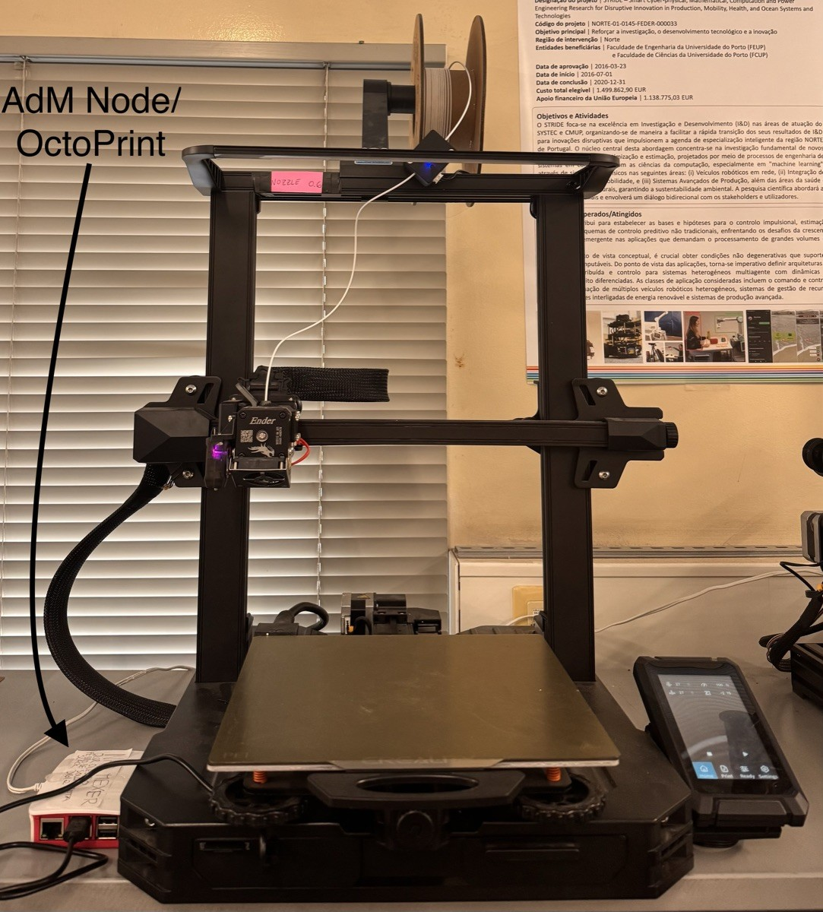

# IIoT Autonomous Maintenance

**Predict a failure, decide when to act, and 3D-print the replacement part before the component breaks: without a human in the decision.**

This repository contains the code, trained models, and results of an MSc dissertation (FEUP, 2026). The earlier version used in the accompanying [article in *Applied Sciences*](https://doi.org/10.3390/app162110974) is also [available](#versions). It implements a closed maintenance loop on a laboratory production line:

1. vibration sensors on the grippers of three robotic arms stream data to edge nodes;
2. on each node, a CNN-BiLSTM model estimates the **Health Index (HI)** of the gripper, from which its **Remaining Useful Life (RUL)** is derived;
3. when the estimated RUL falls below the time needed to print and install a new gripper (plus a safety margin), a prescriptive rule sends a **print order**;
4. a 3D printer starts printing the replacement part, about 210 ms later.

Everything runs as an **IEC 61499** distributed control application (DINASORE runtime) on Raspberry Pi devices communicating over **MQTT**, with supervision over **OPC UA**. In three end-to-end trials on new degradation runs, the part was completed 57 to 73 minutes before the gripper failed.



## Versions

| Version | For | Where |
|---|---|---|
| `v2.0-dissertation` | The MSc dissertation. Latest version: start here | This branch (`main`) |
| `v1.0-article` | The article in *Applied Sciences*. Earlier code, models, and trials, kept as a record | [`article` branch](https://github.com/pedrodsmota/iiot-autonomous-maintenance/tree/article) |

The results of the two versions come from different models and trials; the [README of the article version](https://github.com/pedrodsmota/iiot-autonomous-maintenance/blob/article/README.md) compares them.

---

## Repository map

Each folder corresponds to a part of the system and to sections of the dissertation.

| Folder | What it contains | Dissertation |
|---|---|---|
| [`acquisition/`](acquisition/) | Sampling utilities for the ADXL345 and MPU9250 (C, SPI) and the Raspberry Pi Pico W firmware for the piezoelectric sensor | §5.3 |
| [`prognostics/`](prognostics/) | Offline pipeline, numbered in order of execution: preprocessing, features, health labels, dataset, tuning, training, baselines, evaluation with whole sessions held out, threshold calibration | §5.4, §5.6, §6.3, §7.2 |
| [`online/`](online/) | Online estimation scripts that run on the edge (PdM) nodes and reproduce the training preprocessing exactly | §5.5 |
| [`iec61499/`](iec61499/) | Custom DINASORE function blocks, the 4diac system configuration, and deployment notes | §4.3, §5.2, §5.6 |
| [`models/`](models/) | Trained models, scalers, and best hyperparameters | §5.4.3 |
| [`results/`](results/) | Metrics, baselines, evaluation with whole sessions held out, thresholds, and figures | §5.6, §6.3 |
| [`validation/`](validation/) | Scripts and procedures of the validation tests (trigger latency, end-to-end response time) | §6.4, §6.5 |
| [`dataset/`](dataset/) | Data card, per-session metadata, and conversion scripts of the dataset | §5.3 |
| [`notebooks/`](notebooks/) | Explore the dataset; reproduce the figures and tables from the trained models | - |
| [`docs/`](docs/) | [Architecture](docs/architecture.md), [testbed](docs/testbed.md), and figures | §4, §5.1 |
| [`environment/`](environment/) | Python packages and versions of each machine (training computer, PdM nodes, AdM node) | - |

---

## Quick start

### 1. Look at the results without training anything

```bash
git clone https://github.com/pedrodsmota/iiot-autonomous-maintenance.git
cd iiot-autonomous-maintenance
python -m venv .venv && source .venv/bin/activate
pip install -r environment/requirements.txt
jupyter lab notebooks/02_results.ipynb
```

The notebook reads the files in `results/` and rebuilds the main figures and tables of the dissertation, without the dataset and without a GPU.

### 2. Reproduce the whole pipeline

1. Download the dataset into `data/` (commands in [`data/README.md`](data/README.md)), so that you have `data/raw/` and `data/metadata/`.
2. Run the pipeline:

```bash
cd prognostics
python 01_sync_data.py               # resample to 2800 Hz + causal high-pass filter
python 02_extract_features.py        # 11 features per 1-s window and channel
python 03_pca_features.py            # PCA (used only to build the labels)
python 04_construct_health_labels.py # GMM health stages -> Health Index labels
python 05_build_dataset.py           # block split, scaler, contiguous sequences
python 06_tune_hyperparameters.py    # Optuna (the longest step)
python 07_train_final_model.py       # final models + test metrics
python 08_evaluate_baselines.py      # random forest, ridge, amplitude regression
python 09_loso_eval.py adxl          # whole sessions held out (also: piezo, mpu)
python 10_choose_thresholds.py       # target RUL = time to act + error margin
python 11_loso_decision_zone_error.py
```

Or run everything with `bash prognostics/run_all.sh`. Steps 6 and 9 train many models and take the longest. Step 1 needs about 36 GB of disk; to skip steps 1 and 2, use the features included in the dataset ([details](prognostics/README.md)). To keep the data elsewhere, set `IIOT_DATA_DIR=/path/to/data`.

Expected results (Table 6.3 of the dissertation; small differences between CPU, CUDA, and Apple MPS are normal):

| Sensor | HI RMSE | HI MAE | RUL MAE after the FPT |
|---|---|---|---|
| ADXL345 | 0.0492 | 0.0292 | 0.49 h |
| Piezoelectric | 0.0412 | 0.0294 | 0.57 h |
| MPU9250 | 0.0840 | 0.0472 | 0.93 h |

### 3. Deploy on the testbed

See [`iec61499/README.md`](iec61499/README.md): installing DINASORE, copying the function blocks, configuring the brokers, and starting the online estimation on each node.

---

## Dataset

Accelerated run-to-failure of three 3D-printed robotic grippers ([parallel gripper by sthone](https://www.thingiverse.com/thing:4362304), fitted to EEZYbotARM Mk2 arms), each monitored by a different vibration sensor (ADXL345 at 3200 Hz, MPU9250 at 4000 Hz, piezoelectric sensor at ~2800 Hz), over 22 sessions (about 21 hours of operation): 16 healthy sessions, five sessions with progressively introduced faults, and the complete failure.

- **Zenodo** (citable): [doi.org/10.5281/zenodo.23900128](https://doi.org/10.5281/zenodo.23900128)
- **Kaggle** (mirror, with previews and notebooks): [pedrodesousamota/run-to-failure-vibration-of-3d-printed-grippers](https://www.kaggle.com/datasets/pedrodesousamota/run-to-failure-vibration-of-3d-printed-grippers)

The data card, with the protocol, the file formats, and the known issues of the recordings (in particular the replacement of the piezoelectric sensor after session 14), is in [`dataset/README.md`](dataset/README.md).

---

## The testbed

| | |
|---|---|
|  |  |

Three EEZYbotARM Mk2 arms move a piece along a small line, coordinating over MQTT without a central controller. Each arm has a control device, a sampling device (except Arm #2, whose piezoelectric sensor is read by a Pico W), and a PdM node that runs the online estimation and the prescriptive rule: nine Raspberry Pi 3 boards in total, plus the Pico W. An Ender-3 S1 Pro printer, driven by OctoPrint and a DINASORE node, prints the replacement gripper (3 h 26 min). More in [`docs/testbed.md`](docs/testbed.md).

---

## External dependencies

These projects are used as they are and are **not** included in this repository (the Python packages and their versions are in [`environment/`](environment/)):

| Project | Used for | Version |
|---|---|---|
| [DINASORE](https://github.com/DIGI2-FEUP/dinasore) | IEC 61499 runtime (Python function blocks) | tag `v0.1` and commit `d428b74`, depending on the node ([why](iec61499/README.md#dinasore-versions)) |
| [Eclipse 4diac IDE](https://eclipse.dev/4diac/) | Development and deployment of the applications | 1.11.0 |
| [adxl345spi](https://github.com/nagimov/adxl345spi) | ADXL345 sampling (a modified version is in `acquisition/adxl345/`, GPL-3.0) | commit `a05f03a` |
| [OctoPrint](https://octoprint.org/) / [OctoPi](https://octoprint.org/download/) | 3D printer server | OctoPrint 1.11.7 on OctoPi 1.1.0 |
| [Mosquitto](https://mosquitto.org/) | MQTT broker on each receiving node | Raspberry Pi OS package |

---

## How to cite

If you use this code or the dataset, please cite the dissertation and/or the article (see also [`CITATION.cff`](CITATION.cff)):

Dataset: P. Mota, "Run-to-failure vibration dataset of 3D-printed robotic grippers," version 1.0, Zenodo, 2026. https://doi.org/10.5281/zenodo.23900128

> P. Mota, "Leveraging IEC 61499 for Autonomous Maintenance: Digital Twin Integration and 3D Printing in Distributed Control Systems," MSc dissertation, Faculty of Engineering, University of Porto, 2026.

> P. Mota and R. Pinto, "An Industrial IoT Architecture for Autonomous Maintenance: Integrating Digital Twins, Distributed Control, and On-Demand Additive Manufacturing," *Applied Sciences*, vol. 16, no. 21, art. 10974, 2026. https://doi.org/10.3390/app162110974

## License

- Code: [MIT](LICENSE), except `acquisition/adxl345/`, which is a modified version of adxl345spi and is distributed under the [GPL-3.0](acquisition/adxl345/LICENSE).
- Dataset, trained models, results, and documentation: [CC BY 4.0](https://creativecommons.org/licenses/by/4.0/).
- `iec61499/replacement_part/gripper.gcode`: [CC BY-NC](iec61499/replacement_part/README.md) (non-commercial use only), the license of the gripper from which it was sliced.

## Acknowledgements

Developed at SYSTEC-ARISE and DIGI2, Faculty of Engineering, University of Porto, under the supervision of Prof. Rui Pinto.

---

<sub>Feito com ☕, paciência e muitas garras partidas na FEUP, no Porto. 🇵🇹</sub>
