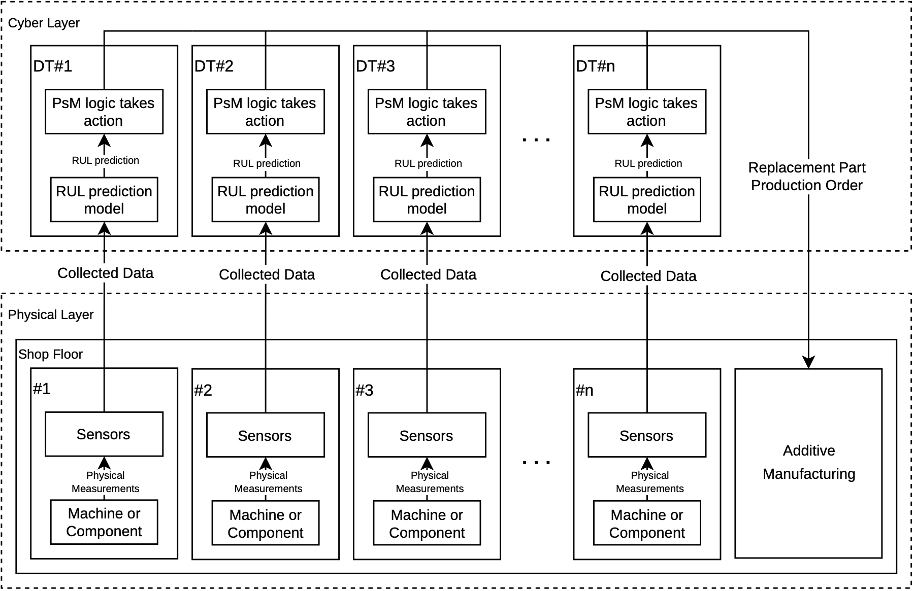
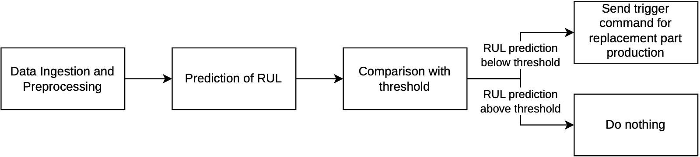

# Architecture

How the parts of this repository fit together (dissertation, Chapter 4).

## From vibration to a printed part

Each arm has its own independent chain; only the printer is shared.

| # | What happens | Where | Code |
|---|---|---|---|
| 1 | The sensor on the gripper is sampled and streamed | Sampling device (Pico W on Arm #2) | [`acquisition/`](../acquisition/), `IMU_STREAM` |
| 2 | Resample to 2800 Hz, causal 1 Hz high-pass filter, 11 features per 1-s window and channel | PdM node | [`online/`](../online/) |
| 3 | A CNN-BiLSTM reads the last 60 windows and estimates the Health Index (HI) | PdM node | [`online/`](../online/), [`models/`](../models/) |
| 4 | The HI is smoothed and converted into a Remaining Useful Life (RUL) | PdM node | [`online/`](../online/), `RUL_ESTIMATION` |
| 5 | If the RUL falls below the threshold of the arm, a print order is published once | PdM node | `RUL_THRESHOLD` |
| 6 | The order is started if the printer is idle, and held otherwise | AdM node | `PRINT_QUEUE`, `PRINT_START` |
| 7 | OctoPrint prints the replacement gripper, and its progress is monitored | AdM node | `PRINT_CHECK` |
| 8 | An operator installs the printed part, which ends the loop | - | - |

The function blocks are in [`iec61499/`](../iec61499/). The models and thresholds are
produced offline by [`prognostics/`](../prognostics/), from the
[dataset](../dataset/README.md).

## The decision

The threshold is the time needed to act (3.6 h: printing plus replacing the gripper) plus
a safety margin taken from the error of the model of each sensor: 4.47, 3.93, and 4.63 h
for Arms #1, #2, and #3.

## Why the model runs outside the function block

DINASORE does not run on Python versions recent enough for the PyTorch version of the
models. `RUL_ESTIMATION` therefore launches the online script as a separate process, in its
own virtual environment, and reads its estimates from a small file that the script rewrites
atomically after each estimate.
