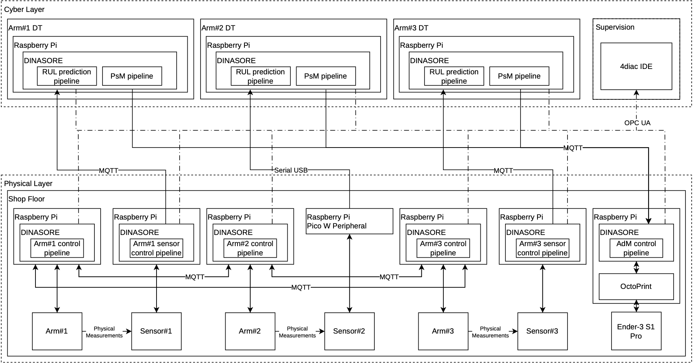
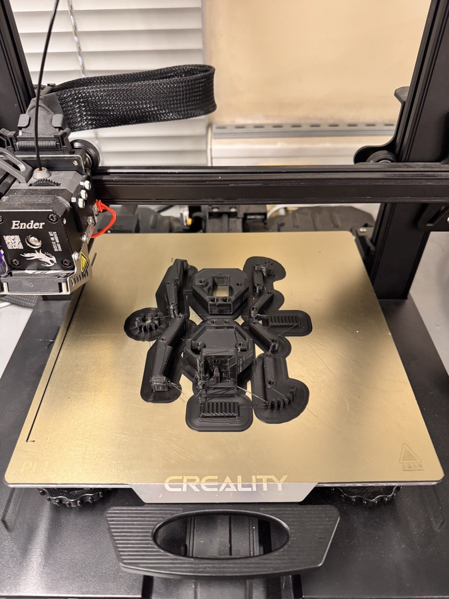

# Testbed

Laboratory-scale production line used to implement and validate the maintenance loop
(dissertation, Section 5.1).

## Equipment

- 3 x [EEZYbotARM Mk2](https://www.instructables.com/EEZYbotARM-Mk2-3D-Printed-Robot/) robotic arms (3D-printed PLA), with the
  ["Parallel Gripper for EEZYbotARM MK2" by sthone](https://www.thingiverse.com/thing:4362304), servo motors driven by a Waveshare
  Servo Driver HAT (PCA9685) on each control device.
- 1 x Creality Ender-3 S1 Pro 3D printer (0.6 mm nozzle, PLA) - the additive
  manufacturing (AdM) node.
- 9 x Raspberry Pi 3 Model B V1.2 and 1 x Raspberry Pi Pico W.
- Sensors: ADXL345 (Arm #1), DFRobot DFR0052 piezoelectric (Arm #2), MPU9250 (Arm #3).

## Devices

| Asset | Device | Role |
|---|---|---|
| Arm #1 | Raspberry Pi 3 (control) | Drives the servo motors; coordinates with the other arms over MQTT |
| | Raspberry Pi 3 (sampling) | Samples the ADXL345 and streams the data |
| | Raspberry Pi 3 (PdM node) | Estimates the HI and the RUL; decides whether to print |
| Arm #2 | Raspberry Pi 3 (control) | as above |
| | Raspberry Pi Pico W | Samples the piezoelectric sensor (USB serial to the PdM node) |
| | Raspberry Pi 3 (PdM node) | Reads the serial stream; estimates the HI and the RUL; decides whether to print |
| Arm #3 | Raspberry Pi 3 (control) | as above |
| | Raspberry Pi 3 (sampling) | Samples the MPU9250 and streams the data |
| | Raspberry Pi 3 (PdM node) | Estimates the HI and the RUL; decides whether to print |
| AdM | Raspberry Pi 3 (AdM node) | OctoPrint + DINASORE: queues, starts, and monitors print jobs |

Every Raspberry Pi runs its own DINASORE instance. They communicate over Wi-Fi, except
for the high-rate vibration streams: Ethernet between the sampling device and the PdM
node of Arms #1 and #3, and USB serial from the Pico W on Arm #2. In the experiments,
the arms were in one laboratory (behind its own router, connected to the campus
network) and the printer in another (on the campus Wi-Fi), so print orders crossed the
campus network.

## Production cycle

Six movements carry a piece from one end of the line to the other and back. When an
arm completes a movement, it publishes a message to the broker of the arm that must
perform the next one; no device orchestrates the cycle.

| Step | Arm | Movement | Triggered by topic |
|---|---|---|---|
| 1 | #1 | left -> center-left | `/ARM1_12/RUN` |
| 2 | #2 | center-left -> center-right | `/ARM2_23/RUN` |
| 3 | #3 | center-right -> right | `/ARM3_23/RUN` |
| 4 | #3 | right -> center-right | `/ARM3_32/RUN` |
| 5 | #2 | center-right -> center-left | `/ARM2_21/RUN` |
| 6 | #1 | center-left -> left | `/ARM1_21/RUN` |

## Replacement part

All the pieces of the gripper are printed in one job from a single G-code file,
[`gripper.gcode`](../iec61499/replacement_part/gripper.gcode) (0.6 mm nozzle, PLA, 0.15 mm
layers, 14 m of filament): 3 h 26 min measured in a trial print (the slicer estimated
2 h 56 min). With about 10 minutes to remove the part and replace the gripper, the time
to act is 3.6 h.

